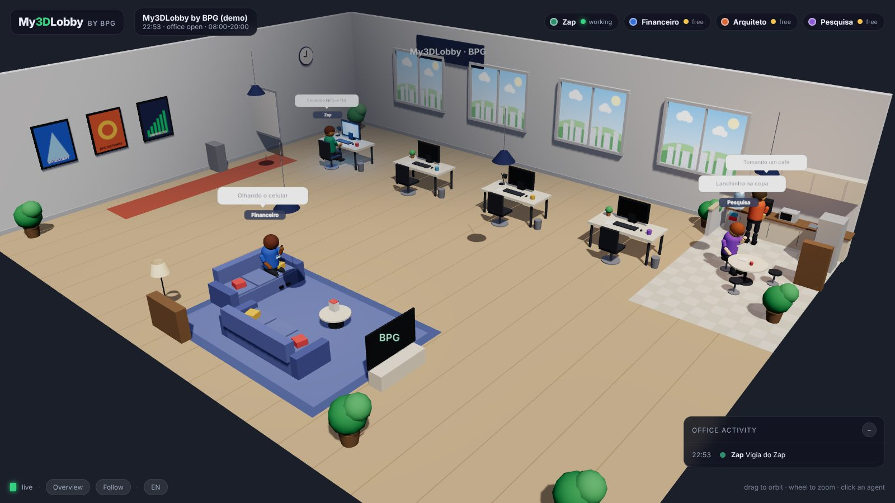
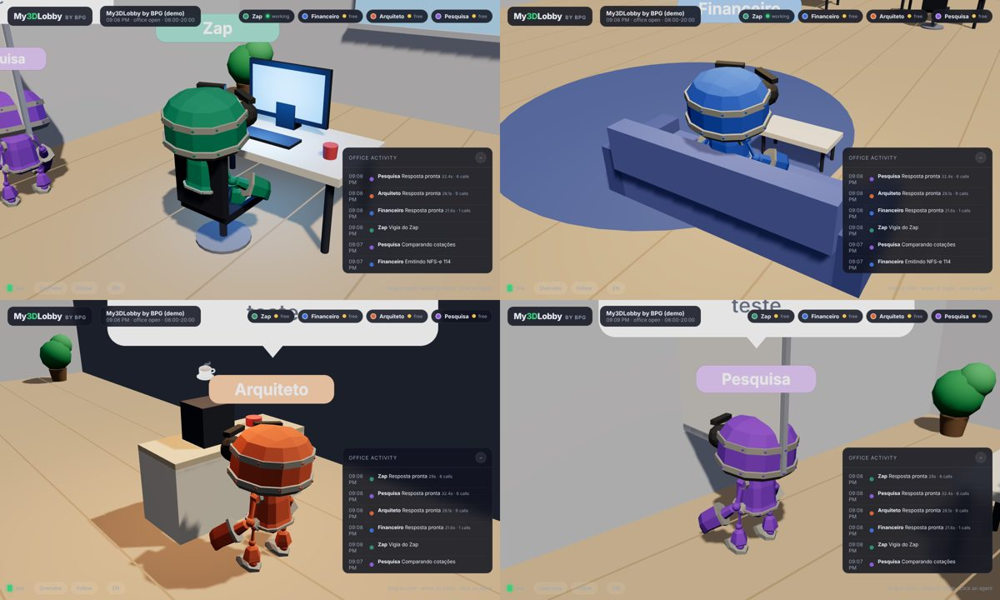

<p align="center">
  
</p>

<h1 align="center">My3DLobby <sup>by BPG</sup></h1>

<p align="center">
  A 3D office where your <a href="https://github.com/NousResearch/hermes-agent">Hermes Agent</a> profiles live.<br>
  Idle agents wander, grab a coffee and lounge on the sofa — when there is work, they run to their desk and type.<br>
  <em>Português mais abaixo ↓</em>
</p>

<p align="center">
  
</p>

## What it does

- **One low-poly person per Hermes profile.** `~/.hermes/profiles/*` is discovered automatically; name, role, shirt colour and desk are configurable. The people are built and animated in code (walk, sit, type, sip coffee, wave, phone, think) — no external models.
- **Real activity, not a random animation.** My3DLobby tails each profile's `gateway.log` (`inbound message` → the agent sits down and works; `response ready` → it is free again), polls `hermes -p <profile> cron list/runs` for scheduled jobs, and can watch any file you point it at (a state file your scripts touch, a log your tools append to).
- **The rule of the office:** working → desk + monitor on; free → walking around, coffee corner, sofa, whiteboard, chatting with a colleague; outside office hours → sleeping; error → shaking its head at the desk; profile gone → greyed-out in the corner.
- **Office feed and agent cards.** Click a robot (or its chip) for model, schedules, runs today and recent events. The feed on the right shows what happened, with response time and API calls.
- **Desktop app**, not a browser tab: a pywebview window for macOS and Windows. The Windows notebook can open the Mac's office over the LAN.
- **Read-only and secret-free.** It never writes to `~/.hermes`, never reads `.env`, keys or tokens — only the `model:` line of `config.yaml` and the logs.
- **Zero dependencies** for the server (Python standard library). three.js is vendored.

<p align="center">
  
</p>

## Quick start

```bash
git clone https://github.com/alexgotardi93-lgtm/My3DLobby.git
cd My3DLobby
python3 -m pip install pywebview          # only for the desktop window
python3 app/my3dlobby_app.py              # reads your local Hermes
python3 app/my3dlobby_app.py --demo       # no Hermes? fake agents
```

Browser instead of a window:

```bash
python3 -m my3dlobby --open               # from the server/ folder, or: PYTHONPATH=server python3 -m my3dlobby
```

### Installers

- **macOS:** double-click `app/Instalar no Mac.command`. It creates a private Python environment, installs pywebview and builds `~/Applications/My3DLobby.app` (double-clickable, dockable).
- **Windows:** double-click `app/Instalar no Windows.bat`. It asks for the Mac's address (e.g. `http://192.168.0.10:4455/`) and puts a **My3DLobby** shortcut on the Desktop. On the Mac, double-click `app/Compartilhar na rede (Mac).command` once (it sets `[server] host = "0.0.0.0"` and prints the address).

## Configuration

Copy `my3dlobby.example.toml` to `~/.my3dlobby.toml`. Everything is optional.

```toml
[office]
name = "BPG Sistemas"
hours = "08:00-20:00"        # outside: the agents sleep

[hermes]
home = "~/.hermes"
ignore_profiles = []         # profiles to leave out
cron_busy_seconds = 45       # a cron run keeps the agent at the PC this long

[[agent]]
profile = "zap"
name = "Zap"
role = "WhatsApp support"
color = "#2f8f6f"

[[signal]]                   # optional: files that mean "busy" or feed lines
agent = "financeiro"
path = "~/repos/office/financeiro/eventos.log"
label = "Invoice emitter"
kind = "log"                 # or "touch"
```

## How the status is decided

| Status | Source |
|--------|--------|
| **working** | an `inbound message` in `gateway.log` with no `response ready` yet (max `stale_run_seconds`); a `cron runs` entry within `cron_busy_seconds`; a `[[signal]]` file touched/appended within its `busy_seconds` |
| **error** | an `ERROR` line in the log, or a cron run whose status is not `completed` (3 minutes) |
| **sleeping** | outside `[office] hours` |
| **offline** | the profile folder disappeared |
| **idle** | everything else — walk, coffee, sofa, whiteboard, chat |

## API

`GET /api/state` returns the office, the agents (status, activity, crons, recent events) and the feed. `GET /api/health` is a ping. Port 4455 by default.

## Project layout

```
server/my3dlobby/   stdlib server: config.py, hermes.py (reader), servidor.py (HTTP), demo.py
web/                three.js office: js/office.js, js/humanoid.js, js/characters.js, js/app.js, js/i18n.js
app/                pywebview window + installers (Mac .command / Windows .bat)
my3dlobby.example.toml
```

## Roadmap

- Talk to an agent from its card (Hermes HTTP API).
- More furniture and a day/night cycle driven by the real clock.
- Custom faces/outfits per agent.

## Credits

three.js (MIT), pywebview (BSD). See `THIRD_PARTY.md`. My3DLobby is MIT — © 2026 BPG Sistemas.

---

# My3DLobby by BPG (português)

Um escritório 3D onde os perfis do **Hermes Agent** moram. Enquanto não estão em atividade, os agentes caminham, tomam café e sentam no sofá; quando chega trabalho, vão para o PC e digitam.

**Como funciona**

- Cada perfil em `~/.hermes/profiles/` vira um personagem (nome, função, cor e mesa configuráveis em `~/.my3dlobby.toml`).
- A atividade é real: o My3DLobby lê o `gateway.log` de cada perfil (`inbound message` → senta e trabalha; `response ready` → fica livre), consulta `hermes -p <perfil> cron list/runs` para os agendamentos e pode vigiar arquivos que você indicar (um estado que seu script atualiza, um log que suas ferramentas escrevem).
- Regra do escritório: **trabalhando** → mesa e monitor aceso; **livre** → passeia, café, sofá, quadro, papo com colega; **fora do horário** → dormindo; **erro** → balança a cabeça na mesa; **perfil sumiu** → cinza, no canto.
- Clique num robô (ou no chip dele) para ver modelo, agendamentos, execuções do dia e eventos recentes. O feed à direita mostra o que aconteceu, com tempo de resposta e chamadas de API.
- Abre numa **janela própria** (pywebview), no Mac e no Windows. O notebook Windows abre o escritório do Mac pela rede.
- Só leitura, sem segredos: nunca escreve em `~/.hermes`, nunca lê `.env`, chaves ou tokens — só a linha `model:` do `config.yaml` e os logs.

**Instalar**

- **Mac:** dois cliques em `app/Instalar no Mac.command` → cria `~/Applications/My3DLobby.app`.
- **Windows:** dois cliques em `app/Instalar no Windows.bat` → pede o endereço do Mac (ex.: `http://192.168.0.10:4455/`) e cria o atalho **My3DLobby** na Área de Trabalho. No Mac, dê dois cliques em `app/Compartilhar na rede (Mac).command` uma vez (ele mostra o endereço).
- Sem Hermes por perto: `python3 app/my3dlobby_app.py --demo`.

**Configurar:** copie `my3dlobby.example.toml` para `~/.my3dlobby.toml` e edite nome do escritório, horário, agentes e sinais.

Licença MIT — © 2026 BPG Sistemas. three.js (MIT).
